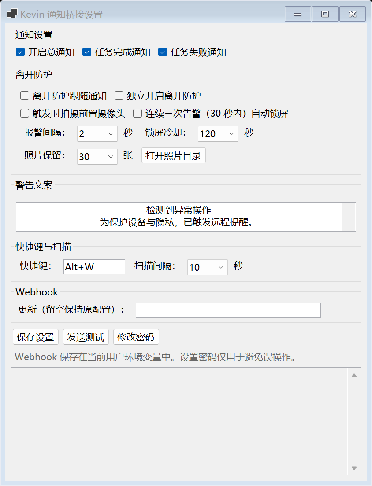
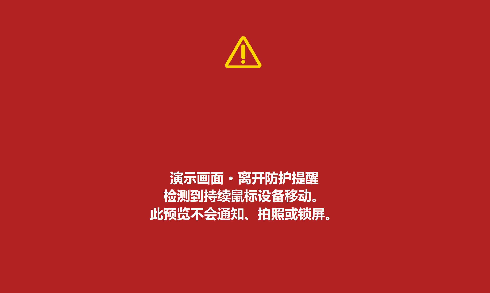
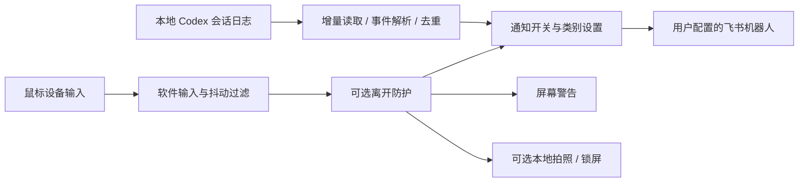

# KevinNotification

**面向 Codex 用户的 Windows 飞书通知工具。** 长任务结束后，把完成摘要或异常提醒发到飞书；通过系统托盘和全局快捷键控制通知，并提供可选的离开防护。

A small Windows tray companion for Codex: Feishu notifications for completed or failed tasks, a global hotkey, and an optional away guard. Built with C# / .NET 8 / WinForms, with a legacy PowerShell entry.

这是个人工具项目，与 OpenAI、Codex 或飞书没有官方关联。推荐使用原生 .NET 入口。

## 功能

- **任务通知**：增量读取本地 Codex 会话事件，区分完成、异常和主动中断，过滤重复事件。
- **托盘与快捷键**：默认 `Alt+W` 开关通知，可分别控制完成通知和失败通知。
- **可选离开防护**：持续鼠标设备移动触发屏幕提醒；可另外开启本地拍照和连续三次告警自动锁屏。
- **输入来源过滤**：结合 Raw Input 和低层鼠标注入标记，减少软件移动光标引起的误报。
- **本地设置**：首次使用自行设置密码；摄像头、自动锁屏和离开防护均默认关闭。

## 界面

以下图片由真实 WinForms 界面使用合成数据渲染，未截取个人桌面、真实通知或摄像头内容。设置窗口为展开后的示例尺寸。





## 快速开始

### 环境

- Windows 桌面环境。
- [.NET 8 SDK](https://dotnet.microsoft.com/download/dotnet/8.0)：从源码构建。单独运行框架依赖构建产物时，需要 .NET 8 **Desktop Runtime**。
- 本机 Codex 在 `%USERPROFILE%\.codex\sessions` 生成 `rollout-*.jsonl` 会话日志。
- 飞书自定义机器人：需要接收手机通知时配置；没有 Webhook 时会记录跳过发送，程序仍可启动。
- 可选：将自行安装的 `ffmpeg.exe` 加入 `PATH`，用于摄像头拍照。仓库不附带 FFmpeg。

### 构建与启动

在仓库根目录打开 PowerShell：

```powershell
dotnet restore KevinNotificationBridgeNative/KevinNotificationBridgeNative.csproj
dotnet build KevinNotificationBridgeNative/KevinNotificationBridgeNative.csproj -c Release --no-restore
& ./KevinNotificationBridgeNative/bin/Release/net8.0-windows/KevinNotificationBridge.exe
```

首次启动会要求设置密码；取消则退出。已有本地设置和密码会继续使用。密码用于打开设置和退出程序，**以明文保存在本地设置文件中，仅用于避免误操作，不构成 Windows 安全边界**。

右键系统托盘图标打开设置，在 Webhook 输入框填入自己机器人的地址并保存，然后点击“发送测试”。返回成功表示飞书接口已接受请求，最终消息以群聊中显示为准。

机器人的创建方式见[飞书自定义机器人官方指南](https://open.feishu.cn/document/client-docs/bot-v3/add-custom-bot)。当前实现只发送普通文本，不生成机器人签名；如果机器人启用了签名校验，需要相应扩展后才能使用。关键词校验也可能拒绝不匹配的通知。

## 数据流与隐私



- 通知包含标题、时间、**最多 120 个字符的项目路径**及**最多 240 个字符的任务摘要或错误信息**，超长部分附省略号。
- 当前没有按项目白名单。启用通知后，会处理默认会话目录中所有项目的新事件；摘要可能包含工作内容，请自行判断是否适合转发到目标群聊。
- Webhook 存在当前 Windows 用户的 `CODEX_FEISHU_WEBHOOK` 环境变量中，不写入项目示例配置。设置界面输入框留空会保持原配置；不要将真实地址放入截图或提交记录。
- 可选摄像头照片只保存在本地，不随通知上传；通知和防护默认都不会上传照片。
- 本仓库的运行配置、通知日志、摄像头照片、构建产物和临时验证文件均被 `.gitignore` 排除。

原生版运行数据位于 `%LOCALAPPDATA%\KevinNotificationBridge\`：

| 文件或目录 | 用途 |
| --- | --- |
| `settings.json` | 用户设置及本地设置密码 |
| `runtime-status.json` | 快捷键注册状态 |
| `notifications.log` | 发送和防护运行状态 |
| `captures/` | 用户主动开启后的摄像头照片 |

[settings.example.json](settings.example.json) 是原生版字段示例，不会自动载入，无须复制。不要覆盖已有运行配置。

## 实现与边界

原生版在 `KevinNotificationBridgeNative/`，托盘、事件监视和飞书通知均在项目内实现，没有第三方 NuGet 包依赖。旧 PowerShell 版保留于 `CodexFeishuBridge/`，两个入口共用 `AwayGuardInput.cs`。

- 依赖 Codex 本地日志的现有结构，当前处理 `event_msg` 中的 `task_complete`、非主动中断的 `turn_aborted` 和部分容量异常。它不是稳定事件接口的兼容承诺；日志格式变化可能导致漏报。
- 只检查最近 24 小时内修改的会话文件，启动时跳过已有事件。没有持久发送队列、自动重试或暂停期间的补发；启动后新出现的文件也先建立读取位置。
- 当前使用默认会话目录，不自动读取自定义 `CODEX_HOME` 路径。
- 离开防护是输入活动提醒，不能识别人或证明有人操作；驱动级虚拟鼠标仍可能表现为设备输入。
- 全局快捷键可能与其他程序冲突，注册状态可查看运行状态文件。

输入采样、过滤规则和可选实机验证见[输入检测说明](docs/input-detection.md)。旧脚本的启动方式与仓库外依赖见[Legacy 说明](docs/legacy.md)。

## 验证

以下默认检查只使用合成设置、合成会话和内存 HTTP 响应，不读取真实通知配置或用户 Webhook，不发送飞书消息，也不拍照或锁屏：

```powershell
dotnet run --project tests/KevinNotificationBridge.Tests.csproj -c Release -- .tmp/native-tests
powershell.exe -NoProfile -ExecutionPolicy Bypass -File tests/Test-AwayGuardInput.ps1
powershell.exe -NoProfile -ExecutionPolicy Bypass -File tests/Test-TrayGuard.ps1
powershell.exe -NoProfile -ExecutionPolicy Bypass -File tests/Test-LegacyBridge.ps1
```

覆盖输入过滤与告警状态、首次使用默认值、已有设置往返、增量事件解析、去重、聊天文本误报过滤，以及未配置 Webhook、HTTP 错误和飞书业务错误。

文档图片可通过下面的命令重新渲染到 `.tmp/native-tests/screenshots/`。它会在屏幕外创建示例窗口，不启动正式托盘或防护：

```powershell
dotnet run --project tests/KevinNotificationBridge.Tests.csproj -c Release -- .tmp/native-tests --render-docs
```

## License

[MIT](LICENSE)。.NET 和可选 FFmpeg 遵循各自许可证；本仓库没有打包这些运行环境或二进制依赖。
